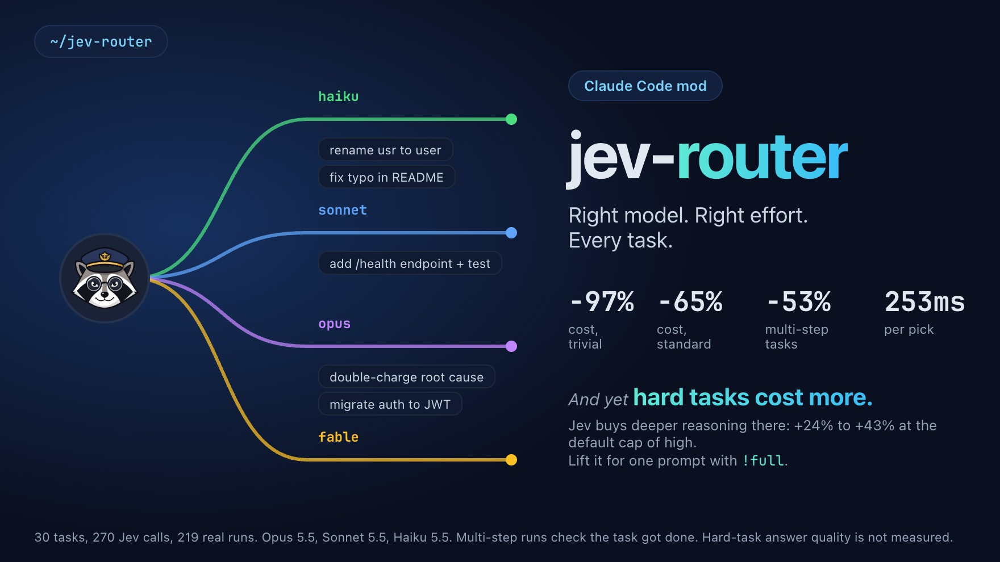
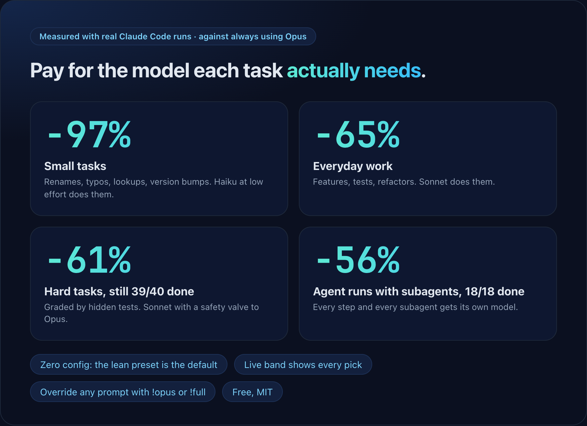
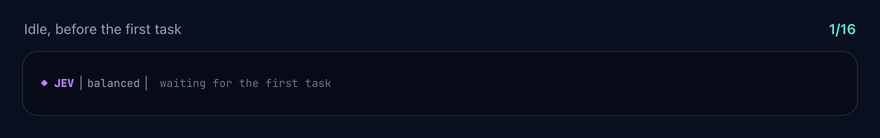
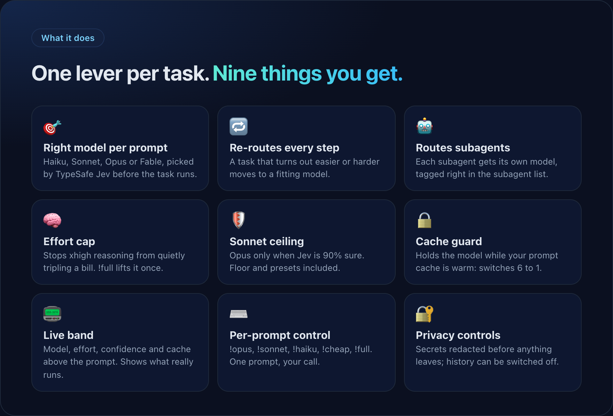
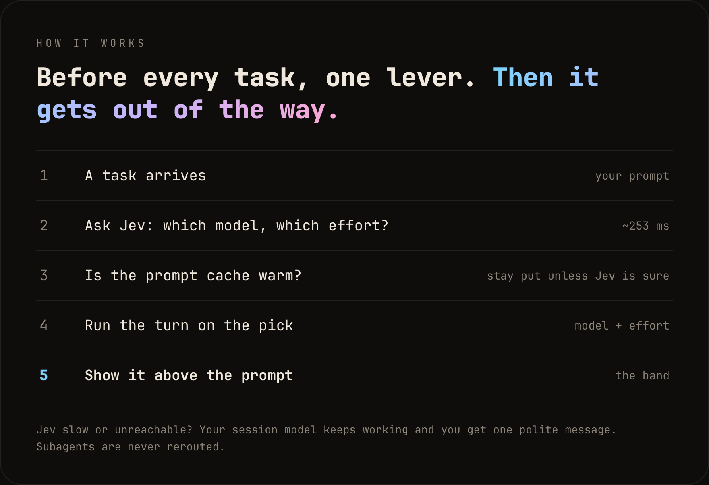
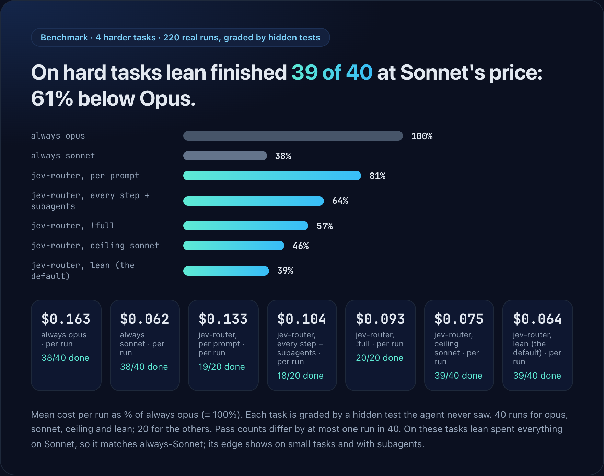
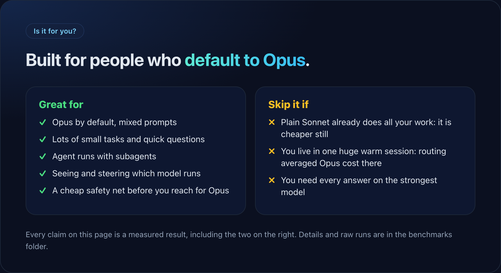
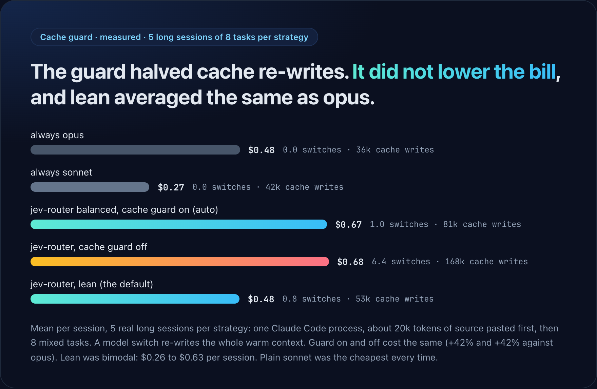
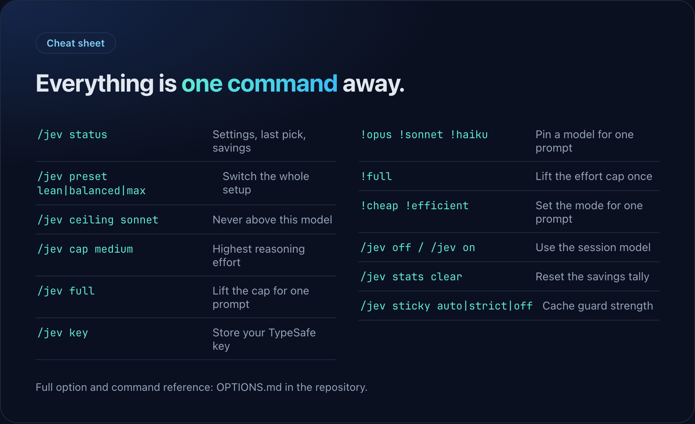

<p align="center">
  
</p>

<h1 align="center">jev-router: automatic Claude model routing for Claude Code</h1>

<p align="center">
  <em>Stop paying Opus prices for rename-a-variable work. Right model, right effort, every prompt, step and subagent.</em>
</p>

<p align="center">
  
  
  
  
</p>

<p align="center">
  
</p>

<p align="center">
  <a href="https://dominicrico.github.io/jev-router/">Website</a> ·
  <a href="#install-the-claude-code-plugin">Install</a> ·
  <a href="#does-it-reduce-claude-code-costs">Proof</a> ·
  <a href="#faq">FAQ</a> ·
  <a href="OPTIONS.md">Reference</a> ·
  <a href="CHANGELOG.md">Changelog</a>
</p>

**jev-router is a free Claude Code plugin that sends each prompt, step and subagent to the cheapest Claude model that can do the job** (Haiku, Sonnet, Opus, Fable), caps runaway reasoning effort, and shows you every pick in a live band above your prompt. No config needed.

## Install the Claude Code plugin

```
/plugin marketplace add dominicrico/jev-router
/plugin install jev-router@jev-router
```

Then `/jev key <your TypeSafe key>` (or set `TYPESAFE_API_KEY`) and run `/jev status`. That is the whole setup: the `lean` preset is on by default.

<p align="center">
  
</p>

## See every pick, live

<p align="center">
  
</p>

## What you get

<p align="center">
  
</p>

<p align="center">
  
</p>

## Does it reduce Claude Code costs?

Yes, on most work, and the benchmarks say where it does not. Every number is a real Claude Code run (hard tasks are graded by hidden tests the agent never sees), and the raw runs are in the repo.

<p align="center">
  
</p>

## Is it for you?

<p align="center">
  
</p>

Long warm sessions are the honest weak spot: the cache guard cuts model switches from 6 to 1 and halves cache re-writes, but the bill stayed the same, and `lean` averaged Opus cost there while plain Sonnet was 43% cheaper. See the chart:

<p align="center">
  
</p>

## Commands

<p align="center">
  
</p>

Every option, preset, command and the privacy details are in [OPTIONS.md](OPTIONS.md). Method, per-benchmark results and caveats are in [benchmarks/](benchmarks/README.md).

## FAQ

**How do I switch between Opus, Sonnet and Haiku automatically in Claude Code?** Install jev-router; it picks per prompt, again before each step, and once per subagent. Pin one prompt with `!opus`, `!sonnet` or `!haiku`.

**How do I reduce Claude Code token cost?** Send easy tasks to cheaper models and cap the reasoning effort. jev-router does both (small tasks −97%, everyday −65% against always Opus). If plain Sonnet already does your work, use that: it was cheapest on the hard set.

**What is the effort cap?** Jev often asks for `xhigh` reasoning on hard tasks, which can triple the tokens. The default `lean` preset limits effort to `medium`; `!full` lifts it for one prompt.

**Does it send my code to a third party?** The prompt, optionally recent messages, and subagent task text go to `api.typesafe.ai`. Keys, tokens, private keys and `password=` style values are redacted first, and `sendHistory` can turn the history off. Details in [OPTIONS.md](OPTIONS.md#privacy).

**Will it slow Claude Code down?** Each Jev call adds about 250 ms; after three failures in a row it pauses for a minute and keeps your current model.

**Why a raccoon?** He is a small creature that gets very serious about picking the right track.

## License

[MIT](LICENSE). Not affiliated with Anthropic or TypeSafe. Security issues: see [SECURITY.md](SECURITY.md).

<sub>Keywords: Claude Code plugin, Claude model router, Claude Code cost optimization, Opus Sonnet Haiku switching, Claude Code subagents, prompt cache, reasoning effort, LLM routing.</sub>
